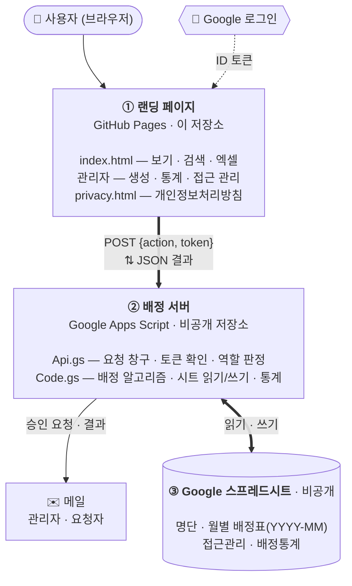
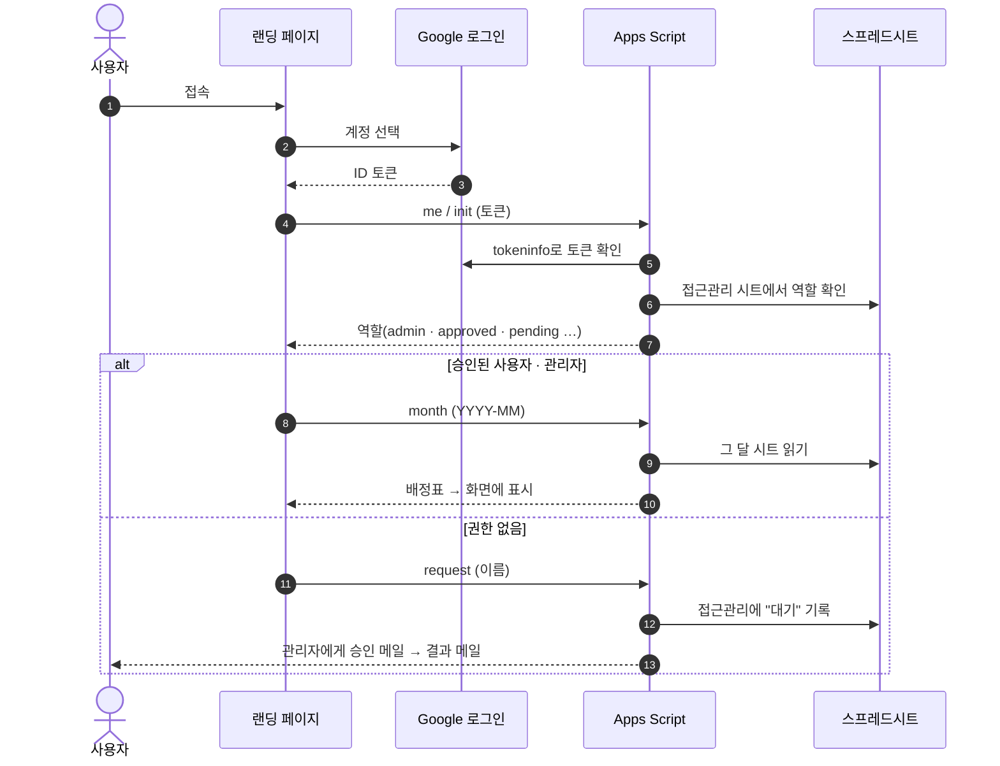
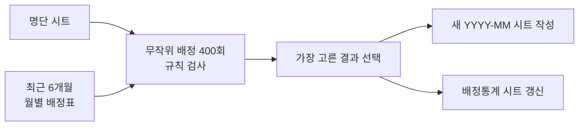

# 주일미사 봉사자 배정

주일학교 전례부의 주일미사 봉사자(해설·독서·보편지향기도) 월간 배정표를 만들고 공유하는 웹 앱입니다.

**주소:** https://gunhojin.github.io/amsa-liturgy/

## 구조

### 요청 흐름

### 배정표 만들기 (관리자)

| 구성 요소 | 위치 | 역할 |
|---|---|---|
| 랜딩 페이지 | 이 저장소 `index.html` | 로그인, 배정표 표시, 관리자 화면. 정적 페이지라 데이터는 없음 |
| 개인정보처리방침 | 이 저장소 `privacy.html` | Google 로그인(OAuth) 게시에 필요 |
| 배정 서버 | Google Apps Script · 코드는 별도 **비공개 저장소** `amsa-liturgy-server` | 배정 생성, 배정표·접근 기록·통계 저장, 메일 발송 |
| 데이터 | Google 스프레드시트 (비공개, 소유자 계정) | 명단, 월별 배정표, 접근 관리, 배정 통계 |

## 동작

### 로그인과 권한
1. 랜딩 페이지에서 Google 계정을 선택합니다(Google Identity Services, 이메일 확인만 요청).
2. 받은 ID 토큰을 매 요청마다 Apps Script API로 보냅니다. 서버는 `tokeninfo`로 토큰과 클라이언트 ID(`aud`)를 확인합니다.
3. 역할에 따라 화면이 달라집니다.

| 역할 | 조건 | 할 수 있는 것 |
|---|---|---|
| admin | 스크립트 소유자, 스프레드시트 편집자 | 보기 + 새로 만들기 + 통계 + 접근 관리 |
| approved | 접근관리 시트 상태 `승인` | 배정표 보기 |
| pending / rejected / none | 그 외 | 접근 요청 (반려 후 재요청 가능) |

### 접근 요청 흐름
요청 → 접근관리 시트에 `대기` 기록 + 관리자에게 메일(바로 승인/반려 링크) → 관리자가 메일 또는 **접근 관리** 탭에서 승인·반려·해제 → 요청자에게 결과 메일.

### 배정 규칙
- 자리: 해설, 독서1, 독서2, 보편 1,2, 보편 3,4 (보편은 각각 한 사람이 두 지향)
- 해설: 역할에 `해설`이 있는 중고등부 / 독서: 중고등부 / 보편: 중고등부가 아닌 보편 전담
- 신입(역할에 `신입`): 독서는 독서2만, 보편은 보편 3,4만
- 명단 선택 열: `활성`이 `X`면 배정 제외, `불가날짜`(예: `12/13, 12/20`)에 적힌 날은 배정하지 않음
- 직전 미사에 맡은 사람은 연속 배정 금지(보편은 인원이 적어 허용하되 최소화)
- 최근 6개월 기록까지 합쳐 횟수가 고르게 되도록 400번 시도 중 가장 고른 결과 채택
- 매월 마지막 주일은 `18시 연합미사`(배정 없음)
- 특전미사: 생성 시 날짜를 골라 추가하면 주일과 함께 날짜순으로 배정

## 내용 고치기

### 스프레드시트에서 (코드 수정 없음)
대부분은 스프레드시트만 고치면 됩니다. 다음에 화면을 열거나 배정표를 만들 때 바로 반영됩니다.

| 하고 싶은 일 | 시트 | 방법 |
|---|---|---|
| 봉사자 추가·삭제 | 명단(첫 번째 시트) | 3행부터 한 줄에 한 명: `학년 \| 이름 \| 세례명 \| 역할` |
| 중고등부 / 보편 전담 구분 | 명단 | `학년`이 `중`·`고`로 시작하면 중고등부(해설·독서), 그 외·빈칸은 보편 전담 |
| 해설 맡기기 | 명단 | `역할`에 `해설` (중고등부만) |
| 신입 표시 | 명단 | `역할`에 `신입` → 독서는 독서2만, 보편은 보편 3,4만 |
| 잠시 배정에서 빼기 | 명단 | `활성` 열을 만들고 `X` |
| 특정 날짜 빼기 | 명단 | `불가날짜` 열에 `12/13, 12/20` 처럼 쉼표로 |
| 만든 배정표 손보기 | `YYYY-MM` | 셀을 직접 고침. 형식은 `이름` 줄바꿈 `(세례명)` |
| 배정표 다시 만들기 | `YYYY-MM` | 관리자 화면 **새로 만들기**에서 덮어쓰기 (또는 시트 삭제 후 생성) |
| 접근 승인·반려·해제 | 접근관리 | `상태`를 `승인` / `반려`로 바꾸거나 행 삭제 (관리자 화면 **접근 관리** 탭과 같음) |
| 관리자 추가 | 스프레드시트 공유 | 스프레드시트 **편집자**로 추가하면 관리자로 인식 |
| 통계 새로 고침 | 배정통계 | 직접 고치지 않음. 배정표 생성·관리자 **통계** 탭 열 때 자동으로 다시 씀 |

### 코드에서
| 바꿀 내용 | 파일 | 위치 |
|---|---|---|
| 배정 자리(열) 구성 | 서버 `Code.gs` | `HEADERS`, `SLOTS` — 바꾸면 화면 머리글은 각 월 시트를 따라감 |
| 연합미사 문구 | 서버 `Code.gs` | `UNION_LABEL` |
| 공평 분배 기간·시도 횟수 | 서버 `Code.gs` | `HISTORY_MONTHS`, `ATTEMPTS` |
| 통계 기간 | 서버 `Code.gs` | `STATS_MONTHS` |
| 명단 스프레드시트 | 서버 `Code.gs` | `ROSTER_SPREADSHEET_ID`, `ROSTER_SHEET_NAME` |
| 접근 요청 재알림 간격 | 서버 `Api.gs` | `RESEND_PENDING_MS`, `RESEND_REJECTED_MS` |
| API 주소·로그인 클라이언트 | 이 저장소 `index.html` | `API_URL`, `CLIENT_ID` (서버 `Api.gs`의 같은 값과 맞춰야 함) |
| 전례색·전례 시기 | 이 저장소 `index.html` | `LIT_COLORS`, `liturgical()` |
| 버전 표기 | 이 저장소 `index.html` | 하단 `
` |
| 링크 미리보기 | 이 저장소 `index.html` `<head>`, `og.png` | `og:title`·`og:description`·`og:image` (카카오톡은 미리보기를 캐시하므로 바로 안 바뀔 수 있음) |

## API (Apps Script `doPost`)

요청 본문: `{"action": "...", "token": "<Google ID 토큰>", ...}` (Content-Type `text/plain`)

| action | 권한 | 추가 값 | 응답 |
|---|---|---|---|
| `me` | 모두 | | `email`, `role`, `name` |
| `request` | 모두 | `name` | `role`, `message` |
| `init` | 보기 이상 | | 월 목록, 처음 보여줄 달, 머리글 |
| `month` | 보기 이상 | `month` (YYYY-MM) | 그 달 시트의 머리글과 배정표 행 |
| `generate` | admin | `month`, `force`, `specialDates[]` | 생성 결과 또는 `exists` |
| `requests` | admin | | 접근 요청 목록 |
| `stats` | admin | | 최근 6개월 사람별 배정 횟수(합계·역할·월별·최근 배정일). `배정통계` 시트도 갱신 |
| `decide` | admin | `email`, `decision` (`approve`/`reject`) | 갱신된 목록 |

## 화면
- 강조색: **다음 미사의 전례색**(녹색·자색·백색(금색 표시)·홍색·장미색). 브라우저에서 전례력을 계산하며, 배정표 날짜마다 전례색 점 표시
- 테마: 시스템 / 기본 / 다크 (브라우저에 저장)
- 검색: 이름·세례명 (띄어쓰기 무시)
- 표: 날짜 열 고정 폭, 나머지 열은 같은 폭. 머리글은 그 달 시트를 그대로 사용
- 로딩 중에는 스피너 표시
- 카카오톡 인앱 브라우저에서 열면 화면을 그리기 전에 휴대폰 기본 브라우저로 자동 전환 (Google 로그인이 인앱 브라우저에서 막힘). 전환이 안 되면 안내 박스(외부 브라우저 열기·주소 복사) 표시, 주소에 `?inapp=1`을 붙이면 전환하지 않음
- 링크 미리보기: 카카오톡·SNS 공유 시 `og.png` 카드 표시 (검색엔진 노출은 `noindex`로 막음)
- 모바일: 표는 가로 스크롤, 버튼·입력칸 전체 폭
- 폰트: 던파 비트비트체 v2(제목), 네오둥근모(본문)
- 스타일 참고: Uiverse.io (andrew-demchenk0 — 카드·버튼, PriyanshuGupta28 — 로더)

## 배포
- **랜딩 페이지**: `main` 브랜치에 push하면 GitHub Pages가 1~2분 안에 반영합니다.
- **배정 서버**: 비공개 저장소에서 `clasp push` → `clasp deploy -i <API 배포 ID>`로 기존 API 배포를 새 버전으로 갱신합니다. URL은 바뀌지 않습니다. (clasp를 쓰지 않을 때는 Apps Script 편집기에 붙여넣고 **배포 → 배포 관리 → API 배포 수정 → 새 버전**)
- 새 권한이 필요한 코드를 올리면 편집기에서 함수를 한 번 실행해 소유자가 승인해야 합니다.
